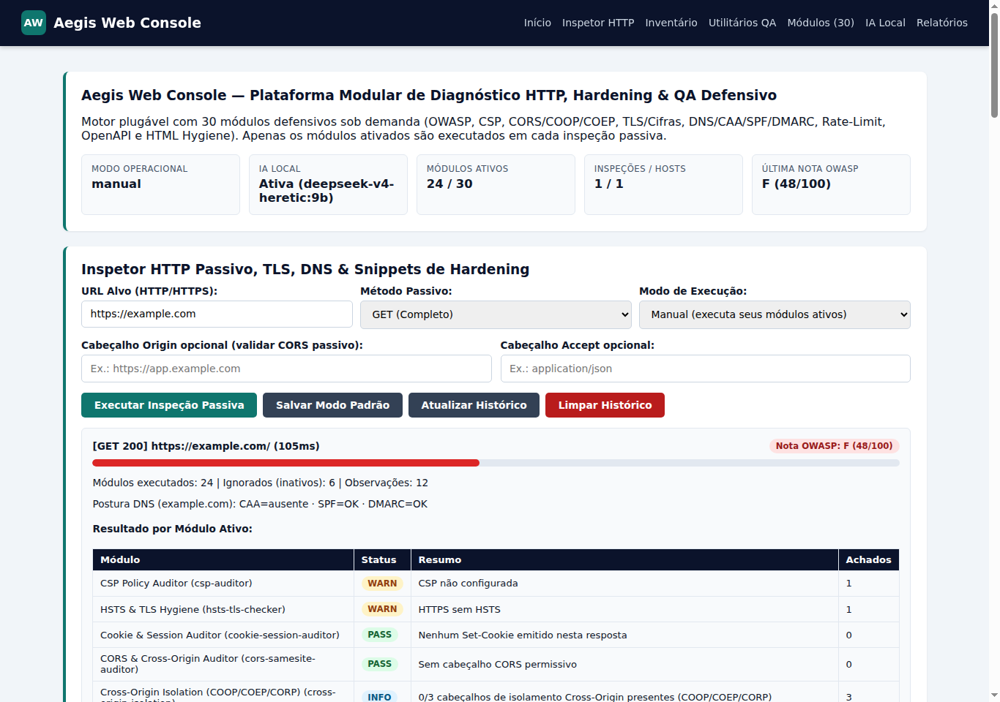
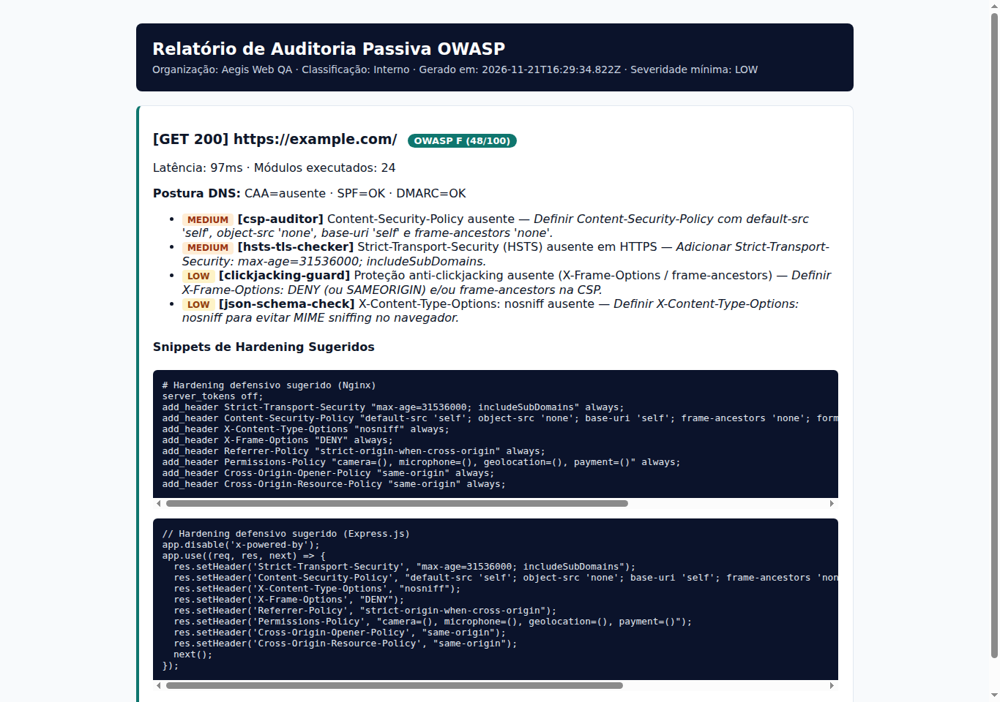

# 🛡️ Aegis Web Console


Plataforma web modular, independente e estritamente **defensiva/passiva** (`v3.0`) para diagnóstico HTTP/TLS/DNS, mapeamento de conformidade (**OWASP Top 10:2021**, **ASVS v4.0** e **CWE**), monitoramento contínuo passivo (**Watchlist** com alertas de regressão e webhooks), **Quality Gate CI/CD** com CLI standalone e exportação **SARIF 2.1.0 / CSV / PDF 1.4 Executivo / HTML / Markdown / JSON**, com suporte opcional a IA (**Ollama Local**, **OpenAI** ou **Anthropic Claude**).

---

## 🖼️ Demonstração Visual (Exemplos)

### 1. Dashboard & Inspetor HTTP Passivo (Saúde OWASP, TLS, DNS e Snippets de Hardening)


### 2. Bancada Web QA (Validador OpenAPI/JSON Schema, Construtor CSP/Headers & CI/CD Quality Gate)


### 3. Gerenciador de 42 Módulos Defensivos Plugáveis & Seleção por Presets / IA


### 4. Relatório Executivo Personalizável (PDF 1.4, HTML, Markdown, SARIF 2.1.0, CSV e JSON)


---

## 🚀 Principais Recursos & Módulos Defensivos (42 Módulos)

- **Execução Modular sob Demanda (`42/42` executores reais):** apenas os módulos marcados como ativos rodam em cada inspeção passiva (`GET`, `HEAD` ou `OPTIONS`).
- **Mapeamento de Conformidade Automático (`compliance_mapper.js`):** cada achado é classificado com **OWASP Top 10:2021**, **OWASP ASVS v4.0**, **CWE**, **Prioridade (`P1`/`P2`/`P3`)** e estimativa de esforço.
- **Cabeçalhos, Redirecionamentos, TLS Profundo & DNS Resiliente:**
  - Parser de **CSP**, **HSTS**, **Clickjacking**, **CORS**, **COOP/COEP/CORP**, **Redirect Chain** (até 5 saltos + detecção de downgrade), **TLS Chain & Key Strength** (cadeia completa, bits RSA/ECDSA, autoassinado, wildcard), **DNS CAA/SPF/DMARC/MX/MTA-STS/DKIM/BIMI/NS/AAAA/Dangling CNAME**, `/.well-known/security.txt` (RFC 9116) e `/robots.txt`.
- **Supply-Chain, Privacidade LGPD/GDPR, APIs & PWA:**
  - Inventário de domínios de terceiros, detector passivo de bibliotecas frontend EOL (`jQuery 1/2`, `AngularJS 1`, `Bootstrap 3`, `Lodash < 4.17.21`), auditoria de trackers/cookies pré-consentimento, **GraphQL Playground / Swagger UI**, **PWA Manifest & Service Worker**, **API Auth/Cache/Error Hygiene**, **OpenAPI 3.x** e **JSON Schema**.
- **Monitoramento Contínuo (Watchlist), Quality Gate CI/CD & CLI Standalone:**
  - Watchlist agendada com gráfico sparkline de tendência, alertas de regressão/expiração TLS e webhooks JSON; endpoint `POST /api/ci/gate`; gerador de **GitHub Actions YAML** e CLI (`node aegis-cli.js audit <url> --min-score 80 --format sarif --out report.sarif`).
- **UI Moderna (Tema Claro/Escuro + Mobile), IA Multiprovidedor & 6 Formatos de Relatório:**
  - Gauge SVG OWASP, modo escuro/claro, tabelas responsivas mobile, snippets para **Nginx / Apache / Express / Caddy / Cloudflare Workers**, IA **Ollama / OpenAI / Anthropic** e exportação **PDF 1.4 Executivo**, **HTML**, **Markdown**, **SARIF 2.1.0**, **CSV** e **JSON**.

---

## 🏗️ Arquitetura do Projeto

```text
aegis-web/
├── webserver.js          # Servidor Express, coleta passiva HTTP/TLS/DNS, API REST, sessão persistente e IA multiprovidedor
├── module_engine.js      # Motor plugável com os 42 módulos defensivos, OpenAPI/JSON Schema, CSP e snippets
├── compliance_mapper.js  # Mapeamento automático para OWASP Top 10:2021, ASVS v4.0, CWE, prioridade (P1–P3) e esforço
├── monitor_engine.js     # Watchlist passiva agendada com tendência, alertas de regressão/TLS e webhooks JSON
├── report_generator.js   # Geradores nativos de relatórios PDF 1.4 Executivo, HTML, Markdown, SARIF 2.1.0, CSV e JSON
├── aegis-cli.js          # CLI standalone para auditoria passiva, Quality Gate CI/CD e geração de SARIF/PDF/CSV
├── modules.json          # Catálogo persistente e estado de ativação dos 42 módulos defensivos
├── index.html            # Interface web single-page responsiva (modo Claro/Escuro, DOM seguro, CSP restritiva, zero CDN)
├── ai_config.json        # Configuração persistente do provedor de IA (Ollama Local / OpenAI / Anthropic / none)
├── test.sh               # Suíte automatizada de testes (sintaxe, 42/42 módulos, API, Watchlist, CI Gate, relatórios e CLI)
├── docs/
│   └── images/           # Capturas de tela ilustrativas sanitizadas (example.com)
├── package.json
├── package-lock.json
└── LICENSE
```

---

## 💻 Requisitos de Sistema / System Requirements

### 🇧🇷 Português (BR) — Configuração Mínima & Recomendada

A arquitetura do **Aegis Web Console v3.0** opera em três perfis de hardware, dependendo se você utiliza apenas a console web e os 42 módulos passivos em modo manual, automação contínua via Watchlist/CLI/API REST em pipelines DevSecOps, ou o modo assistivo com **LLM Local (Ollama)**:

| Recurso | 🟢 Mínimo (Console Web + 42 Módulos Passivos, sem IA) | 🟡 Intermediário (Watchlist + CI/CD Gate + Relatórios PDF/SARIF) | 🔵 Recomendado (Stack Completa + IA Local Ollama) |
| :--- | :--- | :--- | :--- |
| **CPU** | **1 vCPU** (`x86_64` / `arm64`) | **2 vCPUs** (`x86_64` / `arm64`) | **4 a 8+ vCPUs** (`x86_64` c/ AVX2) |
| **Memória RAM** | **256 MB RAM** (consumo do processo ~25–50 MB) | **1 GB a 2 GB RAM** | **8 GB a 16 GB+ RAM** |
| **Armazenamento (SSD)** | **150 MB livres** (Node.js + dependências `npm`) | **500 MB livres** (histórico, relatórios exportados e logs) | **20 GB+ SSD NVMe** (modelos Ollama locais) |
| **GPU (Opcional)** | Não necessária | Não necessária | **NVIDIA 4 GB a 8 GB+ VRAM** (CUDA, opcional para inferência local rápida) |
| **Sistema Operacional** | Linux (Ubuntu 22.04/24.04+, Debian 12+), macOS 12+ ou Windows 10/11 | Linux (Ubuntu/Debian/Alpine), macOS ou Windows | Ubuntu 24.04 LTS / Debian 12+ ou macOS com Apple Silicon |

#### 📦 Consumo por Componente da Arquitetura
- **Servidor Web, Motor Modular, Compliance & Watchlist (`webserver.js`, `module_engine.js`, `compliance_mapper.js`, `monitor_engine.js`, `report_generator.js` — Node.js + Express na porta `3002`)**: ~25 MB a 55 MB de RAM em execução contínua com todos os 42 módulos carregados.
- **CLI Standalone (`aegis-cli.js`)**: execução pontual efêmera (~25 MB de RAM) sem necessidade de manter o servidor web ativo.
- **Interface Web & Bancada QA (`index.html` — Tema Claro/Escuro, Decoder/JWT, Comparer, Entropia, OpenAPI/JSON Schema, Construtor CSP, CI/CD Gate)**: execução local leve no navegador sem dependências externas de CDN.
- **Assistente Defensivo de IA (`ai_config.json` — Ollama Local / OpenAI / Anthropic)**:
  - **Modo Desativado (`ai_type: "none"`)**: Consumo zero de VRAM/CPU extra.
  - **Modo API Remota (`ai_type: "openai"` ou `"anthropic"`)**: Consumo local desprezível (apenas chamadas HTTPS com chave armazenada em `data/ai_secrets.json` `chmod 600` ou variável de ambiente).
  - **Modo Local (`ai_type: "ollama"` em `127.0.0.1:11434`)**: Requer ~3.5 GB de RAM/VRAM para modelos 4B quantizados ou ~5 GB a 6 GB de RAM/VRAM para modelos 7B–9B.

#### 🛠️ Dependências de Software
- **Runtime Core**: `Node.js >= 18.0.0` (requer `fetch` nativo, `AbortSignal.timeout` e módulos padrão `http`, `https`, `tls`, `dns`, `net`, `crypto`, `fs`, `path`) + `npm`
- **Pacotes Node (`package.json`)**: `express ^5.3.0` (geração de PDF 1.4, SARIF 2.1.0, CSV, HTML e Markdown 100% nativa sem binários externos)
- **IA Local (Opcional)**: `Ollama` em execução local ou na rede interna com modelo compatível, ou chave de API `OpenAI` / `Anthropic`

### 🇺🇸 English — Minimum & Recommended Configuration

The architecture of **Aegis Web Console v3.0** supports three hardware profiles depending on whether you run the standalone web console and 42 passive defensive modules manually, integrate its Watchlist/CLI/REST API into DevSecOps pipelines, or enable optional local LLM analysis via **Ollama**:

| Resource | 🟢 Minimum (Web Console + 42 Passive Modules, No AI) | 🟡 Intermediate (Watchlist + CI/CD Gate + PDF/SARIF Reports) | 🔵 Recommended (Full Stack + Local Ollama LLM) |
| :--- | :--- | :--- | :--- |
| **CPU** | **1 vCPU** (`x86_64` / `arm64`) | **2 vCPUs** (`x86_64` / `arm64`) | **4 to 8+ vCPUs** (`x86_64` w/ AVX2) |
| **RAM** | **256 MB RAM** (server footprint ~25–50 MB) | **1 GB to 2 GB RAM** | **8 GB to 16 GB+ RAM** |
| **Storage (SSD)** | **150 MB free** (Node.js + `npm` dependencies) | **500 MB free** (session store, exported reports & logs) | **20 GB+ NVMe SSD** (local Ollama model weights) |
| **GPU (Optional)** | Not required | Not required | **NVIDIA 4 GB to 8 GB+ VRAM** (CUDA, optional for fast local inference) |
| **Operating System** | Linux (Ubuntu 22.04/24.04+, Debian 12+), macOS 12+, or Windows 10/11 | Linux (Ubuntu/Debian/Alpine), macOS, or Windows | Ubuntu 24.04 LTS / Debian 12+ or Apple Silicon macOS |

#### 📦 Resource Usage by Architecture Component
- **Web Server, Modular Engine, Compliance & Watchlist (`webserver.js`, `module_engine.js`, `compliance_mapper.js`, `monitor_engine.js`, `report_generator.js` — Node.js + Express on port `3002`)**: ~25 MB to 55 MB RAM with all 42 pluggable defensive modules loaded.
- **Standalone CLI (`aegis-cli.js`)**: ephemeral single-shot execution (~25 MB RAM) without running the web server.
- **Browser UI & Web QA Workbench (`index.html` — Light/Dark Mode, Decoder/JWT, Comparer, Entropy, OpenAPI/JSON Schema, CSP Builder, CI/CD Gate)**: lightweight client execution with zero external CDN dependencies.
- **Defensive AI Advisor (`ai_config.json` — Local Ollama / OpenAI / Anthropic)**:
  - **Disabled Mode (`ai_type: "none"`)**: Zero extra VRAM/CPU overhead.
  - **Remote API Mode (`ai_type: "openai"` or `"anthropic"`)**: Negligible local footprint (HTTPS calls only; API keys stored locally in `data/ai_secrets.json` `chmod 600` or environment variables).
  - **Local Mode (`ai_type: "ollama"` at `127.0.0.1:11434`)**: Requires ~3.5 GB RAM/VRAM for 4B quantized models or ~5 GB to 6 GB RAM/VRAM for 7B–9B models.

#### 🛠️ Software Dependencies
- **Core Runtime**: `Node.js >= 18.0.0` (built-in `fetch`, `AbortSignal.timeout`, and standard `http`, `https`, `tls`, `dns`, `net`, `crypto`, `fs`, `path` modules) + `npm`
- **Node Packages (`package.json`)**: `express ^5.3.0` (PDF 1.4, SARIF 2.1.0, CSV, HTML, and Markdown generation built natively with zero external binaries)
- **Local AI (Optional)**: `Ollama` running locally or on an internal host with a compatible model, or an `OpenAI` / `Anthropic` API key

---

## ⚡ Instalação e Execução

```bash
git clone https://github.com/heavyscan/aegis-web.git
cd aegis-web
npm install
npm start
```

Por padrão, o servidor escuta na porta `3002` (configurável via variável de ambiente `PORT`):

```bash
PORT=3002 node webserver.js
```

Acesse `http://127.0.0.1:3002` no navegador.

### 🖥️ Uso via CLI Standalone & CI/CD (Quality Gate + SARIF)

```bash
# Auditoria passiva completa com Quality Gate e saída SARIF 2.1.0 (GitHub Code Scanning)
node aegis-cli.js audit https://example.com --preset compliance-full --min-score 80 --max-high 0 --format sarif --out aegis-results.sarif

# Exportação direta em PDF 1.4 Executivo ou CSV
node aegis-cli.js audit https://example.com --format pdf --out relatorio-owasp.pdf
node aegis-cli.js audit https://example.com --format csv --out achados.csv

# Executar a suíte completa de testes automatizados
npm test
```

---

## 🔌 Principais Endpoints REST

| Método | Rota | Descrição |
| :--- | :--- | :--- |
| `GET` | `/api/status` | Estado geral, modo ativo, módulos, saúde OWASP, prioridades P1–P3 e Watchlist |
| `POST` | `/api/mode` | Alterna modo padrão (`manual` ou `ai-automation`) |
| `GET` | `/api/modules` | Lista os 42 módulos defensivos e estatísticas por categoria |
| `POST` | `/api/modules/:id` | Ativa, desativa ou alterna um módulo individual |
| `POST` | `/api/modules/bulk` | Aplica preset (`essential`, `api-qa`, `compliance-full`, `all-on`, `all-off`) |
| `POST` | `/api/inspect/run` | Executa inspeção HTTP/TLS/DNS passiva com os módulos ativos + delta histórico |
| `POST` | `/api/inspect/batch` | Auditoria passiva em lote (até 15 URLs) com resumo consolidado |
| `GET` / `DELETE` | `/api/inspect/history` | Consulta ou limpa o histórico persistente da sessão |
| `GET` | `/api/inventory` | Inventário consolidado de hosts inspecionados |
| `GET` / `POST` / `DELETE` | `/api/watchlist` | Gerencia alvos monitorados periodicamente com alertas de regressão e webhooks |
| `POST` | `/api/watchlist/run` | Dispara varredura passiva imediata da Watchlist |
| `POST` | `/api/ci/gate` | Avalia Quality Gate CI/CD (`min_score`, `max_high`, `max_medium`) com HTTP `200`/`422` |
| `POST` | `/api/qa/validate-schema` | Valida JSON contra JSON Schema ou audita OpenAPI 3.x |
| `POST` | `/api/qa/audit-csp` | Audita diretivas de um cabeçalho CSP offline |
| `GET` / `POST` | `/api/ai/config` | Consulta ou salva provedor de IA (`ollama`, `openai`, `anthropic`, `none`) |
| `GET` | `/api/ai/ollama-models` | Detecta modelos instalados no endpoint Ollama configurado |
| `POST` | `/api/ai/recommend-modules` | Recomenda e aplica subconjunto enxuto de módulos via IA |
| `POST` | `/api/ai/chat` | Consulta defensiva ao assistente de IA |
| `GET` | `/api/report` | Exporta relatório personalizado (`format=pdf\|html\|md\|sarif\|csv\|json`) |

---

## 📄 Licença

Distribuído sob a licença MIT. Consulte [LICENSE](LICENSE).
