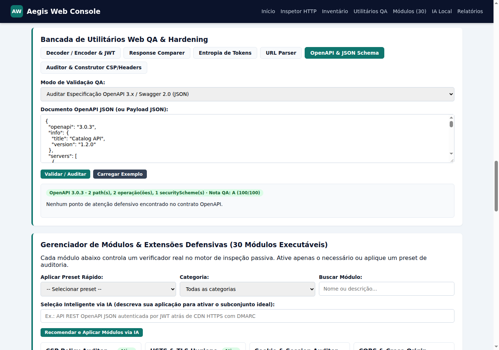
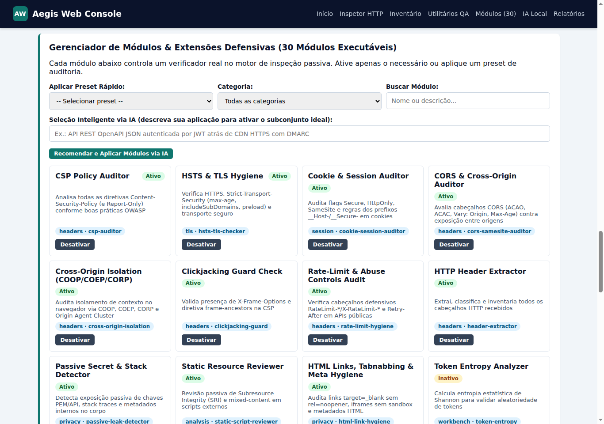

# 🛡️ Aegis Web Console


Plataforma web modular, independente e estritamente **defensiva/passiva** para diagnóstico HTTP, auditoria de hardening OWASP, validação de contratos OpenAPI/JSON Schema, postura TLS/DNS e utilitários de Web QA com suporte opcional a Inteligência Artificial local (**Ollama**).

---

## 🖼️ Demonstração Visual (Exemplos)

### 1. Dashboard & Inspetor HTTP Passivo (Nota OWASP, TLS, DNS e Snippets de Hardening)


### 2. Bancada Web QA (Validador OpenAPI/JSON Schema & Construtor CSP/Headers)


### 3. Gerenciador de 30 Módulos Defensivos Plugáveis & Seleção por Presets / IA


### 4. Relatório HTML Estilizado Personalizável (Exportável também em PDF 1.4, Markdown e JSON)


---

## 🚀 Principais Recursos & Módulos Defensivos (30 Módulos)

- **Execução Modular sob Demanda (`30/30` executores reais):** apenas os módulos marcados como ativos rodam em cada inspeção passiva (`GET`, `HEAD` ou `OPTIONS`), evitando sobrecarga de CPU/memória.
- **Cabeçalhos de Segurança & Isolamento OWASP:**
  - Parser detalhado de **CSP** (`Content-Security-Policy` e `Report-Only`), **HSTS** (`max-age`, `includeSubDomains`, `preload`), **Clickjacking** (`X-Frame-Options` / `frame-ancestors`), **CORS** (`ACAO`, `ACAC`, `Vary: Origin`), **Cross-Origin Isolation** (`COOP`, `COEP`, `CORP`), **Rate-Limit** (`RateLimit-*` / `Retry-After`) e **Cache-Control / CDN**.
- **TLS, Cifras & Postura DNS Passiva:**
  - Inspeção de protocolo negociado (`TLSv1.3` / `TLSv1.2`), força de cifra AEAD, CN, emissor, SANs, janela de expiração e consulta DNS pública passiva de **CAA**, **SPF** e **DMARC**.
- **Sessão, Privacidade & Higiene HTML:**
  - Auditoria de cookies (`Secure`, `HttpOnly`, `SameSite`, prefixos `__Host-`/`__Secure-`), entropia estatística de Shannon em tokens, detecção passiva de exposição de stack/chaves, revisão de SRI/mixed-content em `<script>`, links `target="_blank"` sem `rel="noopener noreferrer"` e `<iframe>` sem `sandbox`.
- **Contratos de API & Bancada Web QA Local:**
  - Validação passiva de JSON + `nosniff` + `charset=utf-8`, auditoria **OpenAPI 3.x / Swagger 2.0**, validador de **JSON Schema**, **Auditor Offline & Construtor de Políticas CSP/Headers**, Decoder/Encoder (`Base64`, `URL`, `HTML`, `Hex`, `SHA-256`, **JWT Inspector**), Response Comparer linha a linha, Entropia de Shannon e URL Parser.
- **Hardening Pronto & Relatórios Personalizáveis:**
  - Pontuação **OWASP (`0–100` / `A–F`)**, snippets copiáveis para **Nginx**, **Apache** e **Express.js**, presets rápidos (`essential`, `api-qa`, `compliance-full`, `all-on`, `all-off`), seleção enxuta por IA local (**Ollama**) e relatórios em **PDF 1.4**, **HTML**, **Markdown (`.md`)** e **JSON** com título, organização, classificação e filtro de severidade mínima.

---

## 🏗️ Arquitetura do Projeto

```text
aegis-web/
├── webserver.js          # Servidor Express, coleta passiva HTTP/TLS/DNS, API REST e geradores de relatórios
├── module_engine.js      # Motor plugável com os 30 módulos defensivos, OpenAPI/JSON Schema, CSP e snippets
├── modules.json          # Catálogo persistente e estado de ativação dos 30 módulos
├── index.html            # Interface web single-page (DOM seguro, CSP restritiva, zero CDN externa)
├── ai_config.json        # Configuração persistente do endpoint/modelo local Ollama
├── docs/
│   └── images/           # Capturas de tela ilustrativas sanitizadas (example.com)
├── package.json
├── package-lock.json
└── LICENSE
```

---

## 💻 Requisitos de Sistema / System Requirements

### 🇧🇷 Português (BR) — Configuração Mínima & Recomendada

A arquitetura do **Aegis Web Console** opera em três perfis de hardware, dependendo se você utiliza apenas a console web e os 30 módulos passivos em modo manual, automação contínua via API REST em pipelines de QA, ou o modo assistivo com **LLM Local (Ollama)**:

| Recurso | 🟢 Mínimo (Console Web + 30 Módulos Passivos, sem IA) | 🟡 Intermediário (QA Contínuo + API REST + Relatórios PDF/HTML) | 🔵 Recomendado (Stack Completa + IA Local Ollama) |
| :--- | :--- | :--- | :--- |
| **CPU** | **1 vCPU** (`x86_64` / `arm64`) | **2 vCPUs** (`x86_64` / `arm64`) | **4 a 8+ vCPUs** (`x86_64` c/ AVX2) |
| **Memória RAM** | **256 MB RAM** (consumo do processo ~20–40 MB) | **1 GB a 2 GB RAM** | **8 GB a 16 GB+ RAM** |
| **Armazenamento (SSD)** | **150 MB livres** (Node.js + dependências `npm`) | **500 MB livres** (relatórios exportados e logs) | **20 GB+ SSD NVMe** (modelos Ollama locais) |
| **GPU (Opcional)** | Não necessária | Não necessária | **NVIDIA 4 GB a 8 GB+ VRAM** (CUDA, opcional para inferência local rápida) |
| **Sistema Operacional** | Linux (Ubuntu 22.04/24.04+, Debian 12+), macOS 12+ ou Windows 10/11 | Linux (Ubuntu/Debian/Alpine), macOS ou Windows | Ubuntu 24.04 LTS / Debian 12+ ou macOS com Apple Silicon |

#### 📦 Consumo por Componente da Arquitetura
- **Servidor Web & Motor Modular (`webserver.js` + `module_engine.js` — Node.js + Express na porta `3002`)**: ~18 MB a 45 MB de RAM em execução contínua com todos os 30 módulos carregados.
- **Bancada Web QA no Navegador (`index.html` — Decoder/JWT, Comparer, Entropia, OpenAPI/JSON Schema, Construtor CSP)**: execução local leve sem dependências externas de CDN.
- **Assistente Defensivo de IA Local (`ai_config.json` — Ollama em `127.0.0.1:11434`)**:
  - **Modo Desativado (`ai_type: "none"`)**: Consumo zero de VRAM/CPU extra.
  - **Modo Local (`ai_type: "ollama"`)**: Requer ~3.5 GB de RAM/VRAM para modelos 4B quantizados ou ~5 GB a 6 GB de RAM/VRAM para modelos 7B–9B.

#### 🛠️ Dependências de Software
- **Runtime Core**: `Node.js >= 18.0.0` (requer `fetch` nativo, `AbortSignal.timeout` e módulos padrão `http`, `https`, `dns`, `net`, `fs`, `path`) + `npm`
- **Pacotes Node (`package.json`)**: `express ^5.3.0`, `body-parser ^2.4.0`
- **IA Local (Opcional)**: `Ollama` em execução local ou na rede interna com modelo compatível

### 🇺🇸 English — Minimum & Recommended Configuration

The architecture of **Aegis Web Console** supports three hardware profiles depending on whether you run the standalone web console and 30 passive defensive modules manually, integrate its REST API into QA pipelines, or enable optional local LLM analysis via **Ollama**:

| Resource | 🟢 Minimum (Web Console + 30 Passive Modules, No AI) | 🟡 Intermediate (Continuous QA + REST API + PDF/HTML Reports) | 🔵 Recommended (Full Stack + Local Ollama LLM) |
| :--- | :--- | :--- | :--- |
| **CPU** | **1 vCPU** (`x86_64` / `arm64`) | **2 vCPUs** (`x86_64` / `arm64`) | **4 to 8+ vCPUs** (`x86_64` w/ AVX2) |
| **RAM** | **256 MB RAM** (server footprint ~20–40 MB) | **1 GB to 2 GB RAM** | **8 GB to 16 GB+ RAM** |
| **Storage (SSD)** | **150 MB free** (Node.js + `npm` dependencies) | **500 MB free** (exported reports & logs) | **20 GB+ NVMe SSD** (local Ollama model weights) |
| **GPU (Optional)** | Not required | Not required | **NVIDIA 4 GB to 8 GB+ VRAM** (CUDA, optional for fast local inference) |
| **Operating System** | Linux (Ubuntu 22.04/24.04+, Debian 12+), macOS 12+, or Windows 10/11 | Linux (Ubuntu/Debian/Alpine), macOS, or Windows | Ubuntu 24.04 LTS / Debian 12+ or Apple Silicon macOS |

#### 📦 Resource Usage by Architecture Component
- **Web Server & Modular Engine (`webserver.js` + `module_engine.js` — Node.js + Express on port `3002`)**: ~18 MB to 45 MB RAM with all 30 pluggable defensive modules loaded.
- **Browser Web QA Workbench (`index.html` — Decoder/JWT, Comparer, Entropy, OpenAPI/JSON Schema, CSP Builder)**: lightweight local client execution with zero external CDN dependencies.
- **Local Defensive AI Advisor (`ai_config.json` — Ollama at `127.0.0.1:11434`)**:
  - **Disabled Mode (`ai_type: "none"`)**: Zero extra VRAM/CPU overhead.
  - **Local Mode (`ai_type: "ollama"`)**: Requires ~3.5 GB RAM/VRAM for 4B quantized models or ~5 GB to 6 GB RAM/VRAM for 7B–9B models.

#### 🛠️ Software Dependencies
- **Core Runtime**: `Node.js >= 18.0.0` (built-in `fetch`, `AbortSignal.timeout`, and standard `http`, `https`, `dns`, `net`, `fs`, `path` modules) + `npm`
- **Node Packages (`package.json`)**: `express ^5.3.0`, `body-parser ^2.4.0`
- **Local AI (Optional)**: `Ollama` running locally or on an internal host with a compatible model

---

## ⚡ Instalação e Execução

```bash
git clone https://github.com/heavyscan/aegis-web.git
cd aegis-web
npm install
npm start
```

Por padrão, o servidor escuta na porta `3002` (configurável via variável de ambiente `PORT`):

```bash
PORT=3002 node webserver.js
```

Acesse `http://127.0.0.1:3002` no navegador.

---

## 🔌 Principais Endpoints REST

| Método | Rota | Descrição |
| :--- | :--- | :--- |
| `GET` | `/api/status` | Estado geral, modo ativo, módulos e última nota OWASP |
| `POST` | `/api/mode` | Alterna modo padrão (`manual` ou `ai-automation`) |
| `GET` | `/api/modules` | Lista os 30 módulos defensivos e estatísticas por categoria |
| `POST` | `/api/modules/:id` | Ativa, desativa ou alterna um módulo individual |
| `POST` | `/api/modules/bulk` | Aplica preset (`essential`, `api-qa`, `compliance-full`, `all-on`, `all-off`) |
| `POST` | `/api/inspect/run` | Executa inspeção HTTP/TLS/DNS passiva com os módulos ativos |
| `GET` / `DELETE` | `/api/inspect/history` | Consulta ou limpa o histórico da sessão |
| `GET` | `/api/inventory` | Inventário consolidado de hosts inspecionados |
| `POST` | `/api/qa/validate-schema` | Valida JSON contra JSON Schema ou audita OpenAPI 3.x |
| `POST` | `/api/qa/audit-csp` | Audita diretivas de um cabeçalho CSP offline |
| `GET` / `POST` | `/api/ai/config` | Consulta ou salva configuração do provedor local Ollama |
| `POST` | `/api/ai/recommend-modules` | Recomenda e aplica subconjunto enxuto de módulos |
| `POST` | `/api/ai/chat` | Consulta defensiva à IA local |
| `GET` | `/api/report` | Exporta relatório personalizado (`format=pdf\|html\|md\|json`) |

---

## 📄 Licença

Distribuído sob a licença MIT. Consulte [LICENSE](LICENSE).
